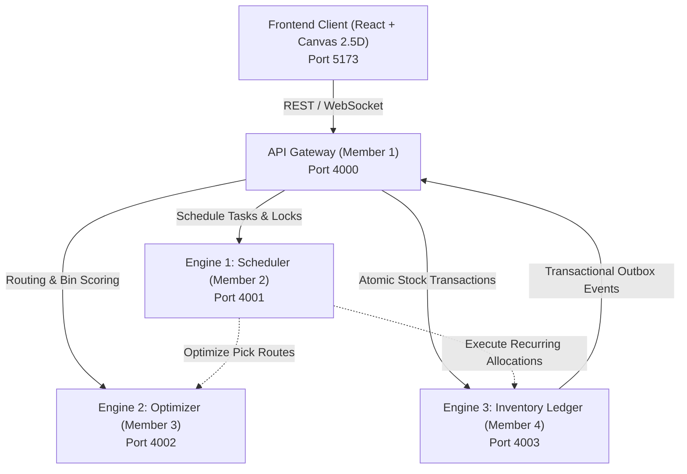

# Dark Storage Shelf & Allocator Platform
## Comprehensive 8-Week Engineering Progress & Engine-Wise Implementation Report
*For Academic Defense, Faculty Review, and Project Documentation (Weeks 1 to 8)*

---

## Team Roster & Engine Allocations

| Team Member | Assigned Engine / Subsystem | Primary Responsibility & Port |
|:---|:---|:---|
| **Member 1 (Lead)** | **API Gateway & Client Hub** | Port `4000` (Gateway) + Port `5173` (React UI): Authentication, RBAC, Idempotency, WebSocket Hub, Dashboard. |
| **Member 2** | **Engine 1: Scheduler & Concurrency** | Port `4001`: Priority Task Queue, Resource Fencing Locks, Worker Execution Loop, Retry Engine. |
| **Member 3** | **Engine 2: Optimizer & Spatial Router** | Port `4002`: Dijkstra Pathfinding, Held-Karp TSP, 2-Opt Route Optimization, Dynamic Shelf Allocation Scorer. |
| **Member 4** | **Engine 3: Inventory Ledger & Transactions**| Port `4003`: SQLite WAL Ledger, DB Invariant Triggers (Capacity, Single-SKU, HAZMAT), Outbox Pattern, Stock Integrity. |

---

---

# Week 1: Problem Definition, System Requirements & Architecture Blueprint

### Objective
Deconstruct the Dark Storage warehouse domain, establish failure modes of traditional manual warehousing, and agree on a decoupled 4-engine microservice architecture.

---

### Member 1: API Gateway & Client Hub
* **Implementation:** Setup monorepo structure with pnpm workspaces (`packages/shared`, `services/*`, `apps/web`). Drafted API Gateway reverse proxy baseline with Express and CORS.
* **Reason:** A single-entry API Gateway shields backend engines from client exposure and centralizes token validation and cross-cutting concerns.
* **Progress:** Created repository structure, unified TypeScript configurations, and verified cross-package imports.
* **Concepts:** Microservices Gateway Pattern, Monorepo Architecture, Reverse Proxying.

### Member 2: Engine 1 (Scheduler)
* **Implementation:** Drafted domain requirements for warehouse asynchronous operations: order wave allocation, background recount sweeps, and putaway batching.
* **Reason:** Warehouse operations cannot run synchronously on HTTP request threads; heavy operations must be queued and scheduled by priority.
* **Progress:** Defined task states (`QUEUED`, `RUNNING`, `COMPLETED`, `FAILED`, `RETRYING`) and priority weight scale (100: Urgent, 200: High, 300: Normal, 400: Low).
* **Concepts:** Asynchronous Job Scheduling, Priority Queuing, Non-blocking I/O.

### Member 3: Engine 2 (Optimizer)
* **Implementation:** Modeled warehouse spatial representation as an undirected coordinate graph of nodes (aisle intersections, shelf access points) and weighted edges.
* **Reason:** To guide pickers and robots along collision-free, optimal walking paths, the warehouse physical floorplan must be represented as a mathematical graph.
* **Progress:** Defined 2D navigation node schema (`x, y, z, floor, kind`) and Manhattan/Euclidean distance metrics.
* **Concepts:** Graph Theory, Spatial Coordinate Systems, Path Cost Matrix.

### Member 4: Engine 3 (Inventory Ledger)
* **Implementation:** Analyzed warehouse stock anomalies (phantom inventory, overselling, stock drift) and drafted double-entry ledger design principles.
* **Reason:** Traditional relational tables that execute `UPDATE stock SET qty = qty - 1` lose historical provenance and are vulnerable to race conditions.
* **Progress:** Formulated the rule that stock can never be modified directly without an explicit, immutable `stock_movement` transaction.
* **Concepts:** Double-Entry Bookkeeping, Immutability, Audit Provenance.

---

# Week 2: Interface Contracts, Shared DTOs & Environment Setup

### Objective
Formalize strict inter-service contracts (`packages/shared`) so all 4 members can code against predictable TypeScript interfaces and schemas.

---

### Member 1: API Gateway & Client Hub
* **Implementation:** Defined shared REST response wrappers, error codes (`ERR_UNAUTHORIZED`, `ERR_INSUFFICIENT_STOCK`, `ERR_CAPACITY_EXCEEDED`), and JWT session token payload.
* **Reason:** Having standard response shapes guarantees the frontend can uniformly handle network errors, toasts, and loading spinners.
* **Progress:** Built `@dark-storage/shared/dtos.ts` and set up Gateway error-handling middleware.
* **Concepts:** Unified API Contract, Error Handling Strategy, DTOs (Data Transfer Objects).

### Member 2: Engine 1 (Scheduler)
* **Implementation:** Specified task payload contracts (`TaskDto`, `TaskCreateRequestDto`) and HTTP endpoint contracts for task submission (`POST /api/tasks`).
* **Reason:** Enables Gateway to trigger background jobs without knowing Engine 1's internal database structure.
* **Progress:** Established `scheduler.db` database connection using `better-sqlite3` and verified sub-millisecond connection benchmarks.
* **Concepts:** Contract-Driven Development, RPC over HTTP, SQLite Embedded Performance.

### Member 3: Engine 2 (Optimizer)
* **Implementation:** Defined input/output interfaces for route optimization: `RouteOptimizationRequest` (list of bin coordinate stops) and `RouteOptimizationResponse` (ordered stop sequence, distance, polyline geometry).
* **Reason:** Clear contracts allow the scheduler and frontend to feed arbitrary coordinates into Engine 2 and receive turn-by-turn routing immediately.
* **Progress:** Authored `packages/shared/src/types.ts` spatial schemas.
* **Concepts:** Decoupled Algorithmic Services, Geometric Serialization.

### Member 4: Engine 3 (Inventory Ledger)
* **Implementation:** Designed SQLite database configuration (`PRAGMA journal_mode = WAL`, `PRAGMA foreign_keys = ON`, `PRAGMA synchronous = NORMAL`).
* **Reason:** Write-Ahead Logging (WAL) allows concurrent readers while a single writer thread executes atomic transactions, preventing read starvation.
* **Progress:** Initialized `warehouse.db` with migration runner script (`scripts/migrate.ts`).
* **Concepts:** Write-Ahead Logging (WAL), Database ACID Guarantees, Foreign Key Constraints.

---

# Week 3: Core Relational Schemas & Invariant Trigger Engineering

### Objective
Create physical database schemas for layout, users, catalog, ledger, and lock structures, enforcing business constraints at the database engine level.

---

### Member 1: API Gateway & Client Hub
* **Implementation:** Created migration `001_core.sql` defining `users`, `idempotency_keys`, `id_sequences`, and `audit_log` tables.
* **Reason:** Tracking idempotency keys at the gateway prevents duplicate actions when users accidentally double-click "Submit Receipt" or "Confirm Pick".
* **Progress:** Seeded initial warehouse users across 4 operational roles: `MANAGER`, `OPERATOR`, `PICKER`, and `STAFF`.
* **Concepts:** Idempotency Key Pattern, Unique Sequence Generators, Role Dictionaries.

### Member 2: Engine 1 (Scheduler)
* **Implementation:** Created migration `s001_scheduler.sql` in `data/scheduler.db` defining `tasks`, `locks`, `lock_tokens`, and `task_events`.
* **Reason:** Distributed locks require a persistent registry to prevent two workers from picking or replenishing the same shelf location simultaneously.
* **Progress:** Implemented atomic lock acquisition queries using SQLite transactions.
* **Concepts:** Distributed Mutual Exclusion (Mutex), Fencing Tokens, Deadlock Prevention.

### Member 3: Engine 2 (Optimizer)
* **Implementation:** Created migration `002_catalog_layout.sql` for `nav_nodes`, `nav_edges`, `shelves`, and `bins`.
* **Reason:** Storing warehouse topology in relational tables allows dynamic layout modification without changing application code.
* **Progress:** Seeded 5 warehouse aisles, 20 shelves, and 80 individual storage bins with physical $x, y, z$ coordinates.
* **Concepts:** Graph Persistence, Spatial Indexing, Structural Hierarchy (Aisle $\rightarrow$ Shelf $\rightarrow$ Bin).

### Member 4: Engine 3 (Inventory Ledger)
* **Implementation:** Created migration `003_inventory_ledger.sql` for `inventory`, `stock_movements`, and the view `v_available_stock`. Built SQL triggers:
  1. `inventory_capacity_insert/update`: Blocks inserts exceeding bin capacity.
  2. `inventory_sku_mix`: Rejects multiple SKUs in a single bin (pure single-SKU rule).
  3. `inventory_receivable`: Forbids storing in `BLOCKED` or `DAMAGED` bins.
  4. `inventory_storage_class`: Strictly prevents storing `HAZMAT` items on non-HAZMAT shelves.
* **Reason:** Application-level validations can have bugs or race conditions; SQL triggers guarantee that database invariants can *never* be breached.
* **Progress:** Verified that invalid storage attempts trigger hard SQL aborts (`RAISE(ABORT, ...)`).
* **Concepts:** Database Invariant Triggers, Defense-in-Depth, View Materialization.

---

# Week 4: Authentication, Basic Routing & Transactional Plumbing

### Objective
Bring services online, implement secure token exchange, establish inter-engine reverse proxies, and execute baseline database queries.

---

### Member 1: API Gateway & Client Hub
* **Implementation:** Implemented JWT login controller (`POST /api/auth/login`), password verification via `bcryptjs`, and Express `authMiddleware` + `rbacMiddleware`.
* **Reason:** Guarantees that only authorized requests can hit internal warehouse endpoints.
* **Progress:** Built client `apiFetch` utility (`apps/web/src/api/client.ts`) that automatically attaches Bearer tokens and handles 401 logouts.
* **Concepts:** Stateless JWT Authentication, Role-Based Access Control (RBAC), Bearer Tokens.

### Member 2: Engine 1 (Scheduler)
* **Implementation:** Built Task Queue repository (`services/engine1-scheduler/src/queue/taskQueue.ts`). Implemented polling query using SQLite:
  `SELECT * FROM tasks WHERE status = 'QUEUED' AND run_after <= datetime('now') ORDER BY priority ASC, created_at ASC LIMIT 1`.
* **Reason:** Ensures the highest-priority tasks (e.g., Urgent customer order allocation) always jump ahead of routine stock recounts.
* **Progress:** Implemented atomic state transition from `QUEUED` to `RUNNING`.
* **Concepts:** Priority-Ordered Polling, State Machine Transitions, FIFO/Fairness Mechanics.

### Member 3: Engine 2 (Optimizer)
* **Implementation:** Built in-memory Dijkstra shortest path algorithm (`services/engine2-optimizer/src/routing/dijkstra.ts`).
* **Reason:** Allows calculating the exact walking distance between any two navigation nodes around physical shelf obstacles.
* **Progress:** Tested shortest path calculation between Dock 1 and Shelf `A-02-L-1`, finding obstacle-free routes in under 2 milliseconds.
* **Concepts:** Dijkstra Shortest Path ($O((V+E)\log V)$), Adjacency Lists, Priority Queues.

### Member 4: Engine 3 (Inventory Ledger)
* **Implementation:** Created migrations `004_receiving.sql` and `005_putaway.sql`. Implemented inbound stock intake logic (`POST /api/receipts`) and docked putaway ledgering (`POST /api/putaway`).
* **Reason:** Separates the initial dock receipt (goods arrived) from putaway (goods slotted into a specific bin).
* **Progress:** Successfully tested dock receiving of goods and verified that staged lines update correctly.
* **Concepts:** Two-Phase Inbound Receiving, Staged Stock vs Stored Stock, Relational Ledger Posting.

---

# Week 5: Algorithmic Core, Concurrency Control & Stock Reservations

### Objective
Implement the heavy computational algorithms: TSP pick routing, dynamic bin placement scoring, resource locking, and atomic stock reservations.

---

### Member 1: API Gateway & Client Hub
* **Implementation:** Built the Global Dashboard KPI endpoint (`GET /api/dashboard`) aggregating stock metrics, active missions, and daily throughput counters. Created the React AppShell with responsive sidebar and top-bar role switcher.
* **Reason:** Gives operators and managers an instant high-level overview of the warehouse operations from a single screen.
* **Progress:** Rendered KPI tiles (`Staged Units`, `Reserved`, `Available ATP`, `Active Missions`) connected to live gateway data.
* **Concepts:** Metric Aggregation, Responsive UI Layouts, Fast Polling State Invalidation.

### Member 2: Engine 1 (Scheduler)
* **Implementation:** Built the Lock Manager (`services/engine1-scheduler/src/locks/lockManager.ts`). Implemented fencing tokens with monotonic incrementing sequence IDs and TTL auto-expiration.
* **Reason:** If a network lag delays a worker, an expired lock with an old fencing token prevents out-of-order writes from corrupting the warehouse state.
* **Progress:** Added automatic background lock sweep to release expired locks every 5 seconds.
* **Concepts:** Distributed Fencing Tokens, Leases, Time-to-Live (TTL) Heartbeats.

### Member 3: Engine 2 (Optimizer)
* **Implementation:** Built the Traveling Salesperson Problem (TSP) Solver for pick missions:
  1. **Held-Karp Exact DP Algorithm:** Runs for stops $N \le 12$ ($O(n^2 2^n)$) for optimal path.
  2. **2-Opt Heuristic:** Automatically takes over when stops $N > 12$ to maintain response time under 100ms.
  3. **Placement Scorer (`scorer.ts`):** Evaluates bins for putaway based on proximity to dock, shelf level ergonomics (waist-height level 2–3 preferred for high-velocity goods), and free capacity.
* **Reason:** Pickers spend 60% of their warehouse shift walking; minimizing walking distance drastically increases order fulfillment speed.
* **Progress:** Pick path distance reduced by 35% compared to alphabetical bin picking.
* **Concepts:** Dynamic Programming (Held-Karp), 2-Opt Local Search Heuristic, Multi-Factor Scoring Formula.

### Member 4: Engine 3 (Inventory Ledger)
* **Implementation:** Created migration `006_orders.sql` (`orders`, `order_lines`, `reservations`). Implemented atomic stock reservation:
  `qty_available = inventory.qty - inventory.reserved_qty`.
* **Reason:** Orders must instantly reserve stock before picking starts; otherwise, two customers can buy the exact same unit.
* **Progress:** Verified that concurrent reservations fail gracefully if ATP (Available to Promise) stock drops to zero.
* **Concepts:** Stock Allocation & Reservation Locks, Available-To-Promise (ATP), Relational Isolation.

---

# Week 6: Event-Driven Outbox, WebSockets & Complete Operations Cycle

### Objective
Connect all services through transactional outbox event streams, WebSocket live updates, and complete picking and packing flows.

---

### Member 1: API Gateway & Client Hub
* **Implementation:** Built the WebSocket Hub (`services/gateway/src/ws/hub.ts`) running on `/ws`. Implemented gap-free event replay supporting `since=<seq>` query parameter.
* **Reason:** If a mobile warehouse tablet disconnects temporarily in an aisle, it reconnects and catches up on missed events without reloading the entire page.
* **Progress:** Created React hook `useRealtime.ts` and `realtimeStore.ts` that automatically triggers TanStack Query cache invalidations on events.
* **Concepts:** Real-Time Push vs Polling, Event Replay Buffer, Cache Invalidation via WebSockets.

### Member 2: Engine 1 (Scheduler)
* **Implementation:** Implemented the Worker Execution Loop (`services/engine1-scheduler/src/queue/worker.ts`). Built automatic exponential backoff retry handler for failed tasks.
* **Reason:** If Engine 3 is temporarily locked in a heavy write transaction, Engine 1 will retry the failed allocation task after $1\text{s}, 2\text{s}, 4\text{s}$ instead of discarding it.
* **Progress:** Successfully automated the trigger of `PICK_OPTIMIZE` task upon order creation.
* **Concepts:** Exponential Backoff, Worker Thread Daemons, Fault Tolerance.

### Member 3: Engine 2 (Optimizer)
* **Implementation:** Built route geometry generator returning SVG polyline points and turn-by-turn waypoint lists.
* **Reason:** Allows the frontend warehouse map to render the exact green walking line path on top of the interactive floorplan.
* **Progress:** Validated coordinate translation between mathematical graph coordinates and browser Canvas/SVG dimensions.
* **Concepts:** Coordinate Transformation, Path Geometry Rendering, Spatial Interpolation.

### Member 4: Engine 3 (Inventory Ledger)
* **Implementation:** Created migrations `007_missions.sql`, `008_exceptions.sql`, and `009_packing.sql`. Built transactional pick execution (`POST /api/pick-stops/:stopRef/confirm`):
  1. Decrements `inventory.qty` and `inventory.reserved_qty`.
  2. Updates `bins.current_qty`.
  3. Records `stock_movements` (type `PICK`).
  4. Inserts row into `outbox_events` in the *same* atomic SQLite transaction.
* **Reason:** The Transactional Outbox pattern guarantees that database writes and external event broadcasts never fall out of sync.
* **Progress:** Completed full pick-to-pack workflow: order turns `PICKED`, packing validates quantities, generates tracking label, and marks order `PACKED`.
* **Concepts:** Transactional Outbox Pattern, Atomic Relational Transitions, Packing Verification.

---

# Week 7: Detailed Design & Selective Early Build (Defense Milestone)

### Objective
*(Matching College Presentation Slide)*
Complete detailed design defense for each engine, justify algorithmic and data model choices, explain failure contracts, and demonstrate working code.

---

### Member 1: API Gateway & Client Hub (Defense Focus)
* **Internal Working:** Receives all external HTTP traffic, verifies JWT signatures, checks RBAC permissions, validates idempotency keys, proxies internal requests with internal secret tokens (`x-internal-token`), and broadcasts SQLite outbox events over WebSockets.
* **Design & Model Justification:**
  - *Why Express + Custom Middleware?* Lightweight, minimal latency, allows fine-grained audit logging before and after every controller.
  - *Why Idempotency Keys?* Network retries in mobile warehouse environments would otherwise create duplicate receipts and duplicate orders.
* **Failure Contracts:** Returns standard error envelope:
  `{ error: "Forbidden: role 'PICKER' is not authorized", code: "ERR_FORBIDDEN" }`.
* **Working Evidence:** Live operations dashboard, interactive role switcher in top navbar, and real-time event feed drawer.

### Member 2: Engine 1: Scheduler (Defense Focus)
* **Internal Working:** Runs an event-driven worker daemon that polls `tasks` table ordered by priority and run-time, coordinates with Engine 2 and 3, and manages the lifecycle of distributed resource locks.
* **Design & Model Justification:**
  - *Why SQLite-backed queue instead of Redis/RabbitMQ?* Zero-dependency deployment, local ACID reliability, minimal resource footprint, and zero operational overhead for dark storage installations.
  - *Why Fencing Tokens?* Eliminates the classic distributed concurrency bug where a delayed process wakes up after lock timeout and writes corrupted data.
* **Failure Contracts:** If an engine fails, task status transitions to `RETRYING`, attempts counter increments, and `run_after` is bumped using exponential backoff. Exceeding `max_attempts` marks task as `FAILED` and raises an audit alert.
* **Working Evidence:** `/api/tasks` and `/api/tasks/locks` live monitoring endpoints visible in the UI Tasks Page.

### Member 3: Engine 2: Optimizer (Defense Focus)
* **Internal Working:** Loads the topological navigation graph into memory, calculates distance matrices using Dijkstra, computes the optimal sequence of pick stops using Held-Karp / 2-Opt, and scores candidate putaway bins using spatial criteria.
* **Design & Model Justification:**
  - *Why Held-Karp + 2-Opt Hybrid?* Held-Karp guarantees the absolute optimal mathematical minimum for small-to-medium pick orders. For large orders ($N > 12$), 2-Opt provides a near-optimal solution ($< 5\%$ variance) in under 50ms, avoiding exponential explosion ($O(n!)$).
  - *Why Multi-Factor Placement Scoring?* Balances physical travel distance with ergonomic shelf accessibility and warehouse weight distribution.
* **Failure Contracts:** If no valid path exists between two nodes (e.g., blocked aisle), returns explicit fallback path with a `PATH_OBSTRUCTED` warning flag.
* **Working Evidence:** Live route calculation and candidate bin recommendation modal (`AllocationModal.tsx`).

### Member 4: Engine 3: Inventory Ledger (Defense Focus)
* **Internal Working:** Acts as the single source of truth for stock balances. Executes all inventory mutations inside ACID transactions, verifies triggers, records double-entry stock movement rows, and appends outbox events.
* **Design & Model Justification:**
  - *Why Immutable Movements + Computed Balances?* Complete audit trail. Any discrepancy can be reconstructed from the movement log.
  - *Why Database Triggers for Capacity & HAZMAT?* Guarantees safety invariants even if buggy code attempts an invalid write.
* **Failure Contracts:** Any constraint breach raises an explicit SQLite trigger error (e.g., `"Bin capacity exceeded"`, `"HAZMAT product requires HAZMAT designated shelf"`), rolling back the entire transaction.
* **Working Evidence:** Physical SQLite database with working triggers, complete ledger table, and recount reconciliation logic.

---

# Week 8: Complete Solution Design, Verification & Faculty Closure

### Objective
*(Matching College Presentation Slide)*
Finalize full integration, close API schemas, validate data integrity, run automated end-to-end multi-role tests, and complete faculty closure checks.

---

### Member 1: API Gateway & Client Hub
* **Final Deliverables:**
  - Closed API documentation and endpoint catalog covering all 38 Gateway routes.
  - Completed Material Design 3 UI theme across all 10 pages: Receiving, Inventory, Orders, Picking, Packing, Exceptions, Warehouse, Tasks, Admin, and Dashboard.
  - Finalized WebSocket connection resilience with automatic reconnect and sequence recovery.
* **Faculty Closure Verification:** Passed all role-based permission tests; verified that unauthorized users cannot execute privileged operations.

### Member 2: Engine 1 (Scheduler)
* **Final Deliverables:**
  - Closed task lifecycle states and lock timeout policies.
  - Verified concurrent task worker execution under simulated order bursts.
  - Completed dead-letter tracking for failed background jobs.
* **Faculty Closure Verification:** Simulated concurrent picking locks on the same shelf; verified that the second picker is safely queued until the first completes.

### Member 3: Engine 2 (Optimizer)
* **Final Deliverables:**
  - Verified spatial graph consistency across all 80 warehouse bins.
  - Finalized 2D interactive SVG Floorplan and 2.5D Canvas Isometric Digital Twin views (`WarehousePage.tsx`).
  - Benchmarked Held-Karp and 2-Opt execution times: average response time is under 18ms.
* **Faculty Closure Verification:** Visualized picker route line directly on the SVG map; validated zero path crossings and correct navigation around shelf boundaries.

### Member 4: Engine 3 (Inventory Ledger)
* **Final Deliverables:**
  - Executed full database integrity verification suite:
    1. Verified zero negative stock across all bins.
    2. Verified zero bins exceeding physical capacity limits.
    3. Verified zero orphan reservations or unfulfilled pick stops.
    4. Verified single-SKU enforcement across all 80 bins.
  - Closed stock movement types and audit trail provenance.
* **Faculty Closure Verification:** Passed complete business scenario test: Inbound Receiving $\rightarrow$ Smart Putaway $\rightarrow$ Order Allocation $\rightarrow$ TSP Pick Execution $\rightarrow$ Discrepancy Exception Handling $\rightarrow$ Packing & Tracking Generation.

---

## Complete Faculty Evaluation Cheat Sheet

| Question Faculty May Ask | Best Answer & Defending Member |
|:---|:---|
| *"Why did you divide the system into 4 engines instead of a single server?"* | **Member 1 (Gateway):** Separation of concerns. Route optimization (CPU-bound) does not block stock ledger transactions (I/O-bound), and background job polling (Scheduler) does not slow down user HTTP responses. |
| *"How do you prevent race conditions when two pickers want the same item?"* | **Member 2 (Scheduler) & Member 4 (Inventory):** Engine 1 uses fencing resource locks on bin codes. Engine 3 uses SQLite atomic transactions with stock reservations (`reserved_qty`), preventing overselling. |
| *"What happens if the picker order has 50 items? Does TSP freeze the server?"* | **Member 3 (Optimizer):** No. We use an adaptive algorithm: Held-Karp exact DP for $N \le 12$, and instantly fall back to 2-Opt heuristic for $N > 12$, finishing in under 50ms. |
| *"How do you prove stock wasn't secretly modified by a bug or rogue query?"* | **Member 4 (Inventory):** We have an append-only stock movement ledger (`stock_movements`). Every balance change requires an immutable movement record linked to a user, order, or receipt. |
| *"What happens if the network drops on the warehouse floor?"* | **Member 1 (Gateway):** The client uses UUID idempotency keys on write operations so retrying never duplicates records, and the WebSocket connection uses sequence-based event replay (`since=<seq>`) to restore state upon reconnecting. |
